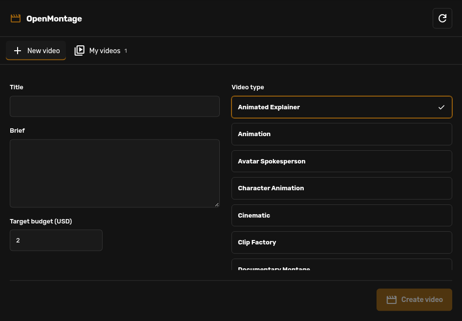

# OpenMontage for Agent Zero

Video production with OpenMontage's pipeline system inside Agent Zero.

Open **OpenMontage** from the sidebar or canvas. Choose a video type, enter a title, brief and media budget, then select **Create video**. A new Agent Zero chat runs the production workflow. Creative approvals happen in chat. **Refresh** reads real checkpoints and rendered videos into the panel.



## Installation

In Agent Zero, open **Plugins → Install from Git** and enter:

```text
https://github.com/3clyp50/a0-openmontage
```

Requires an Agent Zero version with community plugins, native canvas surfaces and Material `x-icon` support, Python 3.12+, Git, FFmpeg and FFprobe on the server. The framework environment must provide PyYAML, jsonschema, Pydantic, Pillow, NumPy, requests and python-dotenv, which are included in the tested A0 runtime. Installation needs HTTPS access to GitHub.

The install hook automatically downloads pinned [OpenMontage](https://github.com/OpenMontageInc/OpenMontage) source and verifies the existing framework dependencies. Upstream tools run in separate Python processes with their own working directory. The plugin installs no packages and changes no shared dependencies. The hook is safe to repeat and never requires an Execute button. No daemon or public port is started.

## Included

- Twelve upstream production pipelines, including explainers, documentaries, cinematic work, animation, podcasts, screen demos and localization.
- Native `openmontage` agent tool for pipeline discovery, resource reading, runtime details, upstream capability checks and project creation.
- Project creation through upstream `lib.checkpoint.init_project`, using its standard project marker and directory layout.
- Stage states and recorded costs read from actual upstream checkpoints, with playable/downloadable files from each project's `renders/` directory.
- FFmpeg-based production using your existing A0 model as orchestrator. Agent Zero reads upstream director skills and runs upstream tools in separate processes.

The panel is a project and checkpoint view, not a second production orchestrator. It does not advance stages, approve work, estimate elapsed progress, or automatically mark a video finished. `In progress` is a persisted checkpoint state, not proof of a currently running process. Use **Refresh** to read new files; the plugin does not poll when closed.

## Providers, budget and optional renderers

The media budget is a requested limit passed to the agent, not a payment authorization or independently enforced spending cap. Zero requests free/local production. The agent must obtain approval for paid generation and retain OpenMontage's checkpoint approval gates and cost tracking. Normal A0 model inference costs are separate.

Supply optional provider keys through the Agent Zero server's environment, following upstream provider documentation. Do not put credentials in project briefs or this repository. `preflight` reports the upstream support envelope; unavailable providers remain unavailable.

Remotion, HyperFrames, local GPU stacks, Piper voices, Google GenAI, Thai word segmentation and individual provider-specific extras are optional. They are not installed by this plugin. The upstream Backlot server is not required for this native panel. Confirm runtime requirements, licensing and installation with the user before adding extras; use an isolated environment for packages that conflict with A0. Choose an available renderer during proposal; do not silently switch it later. FFmpeg/FFprobe are required at installation. The plugin does not promise every upstream provider or renderer works without its own prerequisites.

## Agent tool

`openmontage` supports `status`, `pipelines`, `runtime`, `preflight`, `read`, `create`, and `project`.

```json
{"tool_name":"openmontage","tool_args":{"action":"pipelines"}}
```

Read `AGENT_GUIDE.md`, the selected `pipeline_defs/*.yaml`, each stage's director skill and relevant provider skills. `runtime` returns the exact Python executable, working directory and `OPENMONTAGE_PROJECTS_DIR` value. Use those in the server's code execution tool. OpenMontage's `tools` and `lib` modules run in a separate process to avoid shadowing A0 modules.

The HTTP API retains A0 authentication and CSRF for mutations. Video GET endpoints retain authentication, support byte ranges for seeking and only serve video files from a validated project's `renders/` directory. Directory traversal and symlink escapes are rejected.

## Storage and removal

- Pinned upstream source: `usr/plugins/openmontage/_runtime/`.
- Projects, briefs, checkpoints, assets and final videos: `usr/workdir/openmontage/`.

Disable through **Plugins** to hide the panel and tool. Stop any agent-started render before uninstalling. The plugin owns no persistent server process. Uninstall removes its runtime and code while keeping productions under `usr/workdir/openmontage/`. Optional tools installed elsewhere remain their owner's responsibility.

## Development

Install this repository at `usr/plugins/openmontage/` in an Agent Zero checkout. From that checkout, using its framework environment:

```bash
python -m pytest usr/plugins/openmontage/tests -q
```

Tests cover upstream initialization dispatch, real checkpoint interpretation, requested-budget validation, path and symlink rejection, authenticated video access and range requests. External provider generation is not part of the offline suite.

Upstream source pin: `fecb9a1e3cc23ef84de30b272059457a427f16f8`. Upstream licensing and attribution remain in the downloaded source. This independent community integration uses AGPL-3.0, matching OpenMontage; it is not an official OpenMontage Inc. product.
